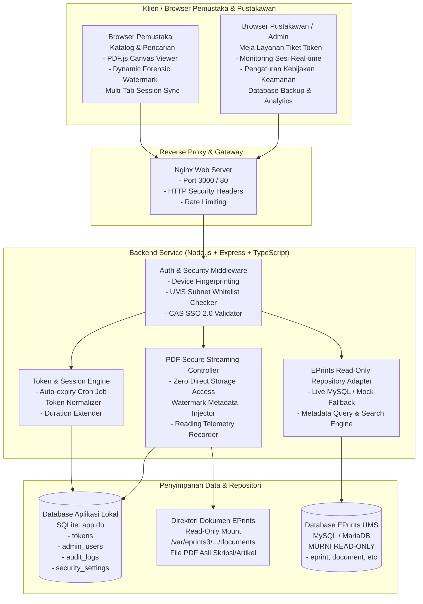
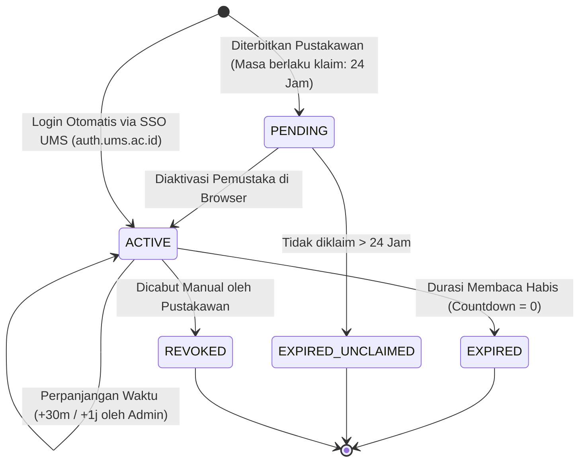

# Arsitektur & Keamanan Sistem — EPrints Unpublish Viewer

> **UPT Perpustakaan dan Layanan Digital**  
> Universitas Muhammadiyah Surakarta (UMS)

Dokumen ini menjelaskan arsitektur perangkat lunak, paradigma keamanan perlindungan karya ilmiah, model pemisahan database, dan siklus hidup sesi pembacaan pada sistem EPrints Unpublish Viewer.

---

## 1. Diagram Arsitektur Sistem



---

## 2. Paradigma Keamanan Inti (Security Architecture)

Sistem dirancang dengan standar perlindungan hak cipta ketat untuk naskah skripsi/tesis/artikel yang berstatus **Unpublish / Embargo / Restriktif**:

### A. Zero Direct Storage Access
- File PDF asli repositori **tidak pernah dibuka atau diekspos melalui static URL publik** (misal `http://.../file.pdf`).
- Pemustaka hanya dapat membaca melalui streaming data terenkripsi berbasis token via endpoint `/api/v1/articles/:id/documents/:docId/view`.
- Setiap chunk streaming diverifikasi secara ketat terhadap keaktifan token sesi, kecocokan IP, dan fingerprint perangkat.

### B. Dynamic Forensic Watermarking
- Di sisi klien, naskah dirender menggunakan kanvas grafis PDF.js.
- Di atas kanvas, diinjeksi lapisan watermark diagonal semi-transparan yang memuat:
  $$\text{Watermark} = [\text{NIM/NIP Pemustaka}] - [\text{Nama Civitas}] - [\text{IP Address}] - [\text{Waktu Akses}]$$
- Watermark ini menempel pada setiap lembar halaman. Jika ada upaya memotret layar (screen capture) atau merekam, identitas pelaku pembocoran naskah langsung terlacak secara forensik.

### C. Proteksi Anti-Copy, Anti-Print, & Anti-Download
- Menu konteks klik kanan dinonaktifkan pada area pembaca.
- Pintasan keyboard browser seperti `Ctrl+P` (Print), `Ctrl+S` (Save), `Ctrl+U` (View Source), dan `Ctrl+Shift+I` (DevTools) dicegah secara otomatis.
- Seleksi teks (text highlighting/copy) dinonaktifkan pada naskah terproteksi.

### D. Device Fingerprint & Lock Binding
- Saat token diaktivasi, sistem menghasilkan hash sidik jari perangkat pemustaka (`x-client-uuid` + user agent).
- Token terkunci ke 1 perangkat/browser tersebut. Jika kode token dibagikan ke orang lain di perangkat berbeda, aktivasi akan ditolak otomatis.

### E. Multi-Tab Session Synchronization (Dual-Channel)
- Sistem memantau status sesi lintas tab browser menggunakan saluran ganda:
  1. `BroadcastChannel('ums_patron_session_channel')` (Latensi 0 ms).
  2. `window.addEventListener('storage')` (Fallback lintas tab).
- Jika pemustaka mengklik **"Keluar Sesi"** pada Tab A, maka Tab B yang sedang membuka naskah langsung otomatis:
  - Mengirim sisa detak jantung baca terakhir (*reading telemetry*) ke server.
  - Menghapus seluruh buffer piksel dari memori kanvas (`ctx.clearRect`).
  - Menutup modal pembaca seketika dan mengunci tampilan.

---

## 3. Pemisahan Database & Integritas Data EPrints

Salah satu keputusan arsitektural paling fundamental adalah **Isolasi Database**:

```
┌────────────────────────────────────────────────────────┐
│               DATABASE EPRINTS UTAMA (UMS)             │
│               - Status: MURNI READ-ONLY               │
│               - Tidak ada INSERT / UPDATE / DELETE     │
└────────────────────────────────────────────────────────┘
                           ▲
                           │ (Query SELECT Metadata)
┌────────────────────────────────────────────────────────┐
│             BACKEND UNPUBLISH VIEWER                   │
└────────────────────────────────────────────────────────┘
                           │
                           ▼ (Baca / Tulis Sesi & Log)
┌────────────────────────────────────────────────────────┐
│               DATABASE LOKAL (SQLite app.db)           │
│               - tokens (Tiket sesi membaca)            │
│               - admin_users (Staf pustakawan)          │
│               - audit_logs (Rekam jejak pembacaan)     │
│               - security_settings (Whitelist IP/Mode)  │
└────────────────────────────────────────────────────────┘
```

> **Keuntungan**: Tidak ada risiko korupsi data atau beban kueri berat pada database induk EPrints kampus. Seluruh operasi pencatatan token, mutasi status, dan log insiden terjadi terisolasi di database lokal `app.db`.

---

## 4. Siklus Hidup Token (Token Lifecycle)



---

## 5. Mekanisme Kebijakan Akses Jaringan UMS & SSO

Sistem mendukung 3 mode kontrol akses yang dapat diubah secara live dari panel admin:

1. **Mode Fleksibel / Hybrid (Default)**:
   - Pengguna di Jaringan Wi-Fi / LAN Kampus UMS (terdaftar di IP Whitelist) dapat **langsung membaca tanpa token**.
   - Pengguna di luar kampus wajib melakukan login SSO UMS atau memasukkan tiket token pustakawan.
2. **Mode Jaringan Kampus UMS Saja (`UMS_NETWORK_ONLY`)**:
   - Naskah hanya dapat dibuka dari lingkungan kampus UMS. Akses dari luar kampus ditolak dengan pesan informatif.
3. **Mode Khusus Tiket Token (`TOKEN_ONLY`)**:
   - Seluruh pemustaka (baik di dalam maupun di luar kampus) wajib memiliki tiket token aktif dari meja layanan pustakawan.
